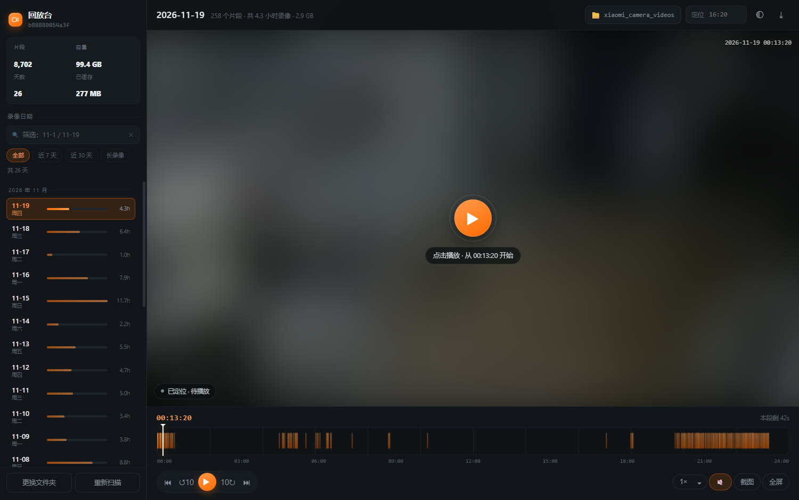
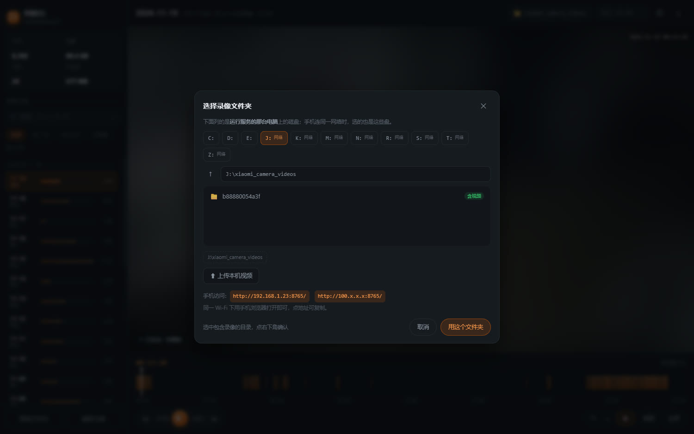
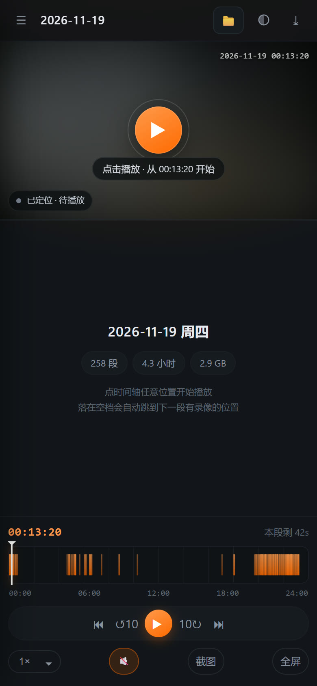

# 米家摄像头回放台 (Xiaomi Camera Viewer)

把米家摄像头导出的碎片录像，整合成一台能拖时间轴、能跨片段连播的本地监控台。

米家摄像头往存储卡里写的是一个小时一个目录、一分钟一个 mp4。想回看某个时间点，只能在几百个文件里翻，或者接受 App 里那个按片段点选的播放器。这个工具把「一天」还原成一条连续时间轴：选日期、拖时间轴、连续播放、随时截图导出。



> 配图里的监控画面做了重度模糊处理，其余界面元素是真实截图。

## 快速开始

```
python server.py
```

浏览器自动打开 `http://127.0.0.1:8765/`，点右上角的文件夹按钮选录像目录。选过之后每次启动都会自动打开上次那个目录。

启动时还会打印一条局域网地址，同一 Wi-Fi 下的手机、平板打开它就能用同一个页面：

```
[*] 本机访问 : http://127.0.0.1:8765/
[*] 手机访问 : http://192.168.2.41:8765/
```

也可以跳过选择，直接指定目录：

```
python server.py --root "D:/xiaomi_camera_videos"
```

只依赖 Python 3.9+ 和系统里的 ffmpeg，没有 pip 依赖。

---

## 选择文件夹

如果录像不在默认位置，或者有好几份备份想换着看，点顶栏的文件夹按钮：



- 顶部是磁盘列表，网络盘会标出来，省得你在一堆映射盘里猜
- 进入目录后会标记哪些子目录里真的有 mp4（标「含视频」），不用挨个点开试
- 底部保留最近打开过的 5 个目录，同时显示手机访问地址
- 选错的代价很低：切过去扫一遍，发现是 0 个片段会自动弹回来让你重选

扫描在后台线程跑，网络盘上扫一万个文件要半分钟，期间页面会显示已读取的条目数，不会像卡死一样白等。

扫描结束不会自动播放。页面停在这一天第一段的画面上，中间一个大播放按钮，点一下才真正开始加载——省得你只是想翻个日期，后台却已经在转码了。换日期同理：只换封面和索引，不碰解码器；真正起播要等你点某个时间点或按播放键。

## 手机访问

默认监听 `0.0.0.0`，同一局域网里的手机、平板用浏览器打开启动时打印的地址即可。竖屏是单独排的版：视频按 16:9 贴顶，中间是当天的日期与统计，时间轴和控件固定在底部，单手够得到。



**手机看到的是运行服务那台电脑的磁盘**，所以：

- 电脑上的 `J:\xiaomi_camera_videos` 在手机上一样能选、能播
- 手机上点「更换文件夹」，盘符列表是电脑的
- 选目录、扫描、转码全部在电脑上完成，手机只负责显示

手机自己相册里的视频，浏览器没法把「一个目录」交给后台（网页只能拿到文件内容，拿不到路径），所以走另一条路：选择器底部有「上传本机视频」，多选后直接传给服务，落在缓存目录的 `uploads/<时间戳>/` 下，传完自动切过去播放。上传的文件会按真实时长排好时间轴，不会全挤在同一秒。

> iOS Safari 支持多选视频，但不支持选整个文件夹；Android Chrome 也一样。要整目录备份还是用数据线拷到电脑上。

## 为什么需要服务端转码

这是整个方案绕不开的前提。米家这批录像的编码：

| 项目 | 实测值 |
| --- | --- |
| 视频 | HEVC (H.265)，2304×1296，10–20 fps 可变帧率 |
| 音频 | PCM A-law (G.711)，16 kHz |
| 封装 | MP4，每段约 60 秒 |
| 码率 | 约 2 Mbps，单段 10–15 MB |

Chrome 和 Edge 默认都解不了这两项：HEVC 需要系统级解码器扩展且依赖硬件，A-law 音频浏览器完全不支持。直接把这些 mp4 丢给 `<video>` 的结果是黑屏，或者有画面没声音。

服务端用 x264 实时转成 H.264 + AAC 再推给浏览器，同时把转好的结果缓存到本地磁盘。第二次播放同一片段就直接读缓存文件，支持 Range 请求，拖动进度条能精确跳转。

## 目录结构约定

默认按 `<根目录>/<摄像头ID>/<YYYYMMDDHH>/*.mp4` 识别，文件名形如：

```
b88880054a3f/2026102516/20M13S_1792916413.mp4
                        └──────┬──────┘
                      Unix 起始时间戳（权威）
```

尾部的 Unix 时间戳是片段时间的唯一可靠来源，`20M13S` 只是整点偏移的冗余显示。文件名不符合规则时退回文件修改时间。目录层级不同也能扫到——递归遍历，只要文件是 mp4 就会纳入索引。

网页上传的视频没有这套命名，时间表写在同目录的 `sources.json` 里（文件名、起始秒、真实时长），扫描时优先读它，这样多段上传能排在连续的时间轴上，而不是挤在同一秒。

## 功能

- **24 小时时间轴**：橙色区块表示有录像的时段，空白就是真的没录。**已缓存的时段颜色更亮**，一眼看出哪些能秒开。点击任意位置开始播放，落在空档会自动落到下一个有录像的点并提示跳过了多久。
- **选日期不自动播**：点日期只换索引、抽一帧当封面，播放器不解码、也不产生转码任务。点时间轴上的某一刻（或顶栏定位、按播放键）才起播。
- **跨片段连播**：播完一段自动接下一段，不需要手动点。切换瞬间保留上一帧画面，避免黑屏。
- **日期筛选**：日子多了翻列表很难受。支持文本筛（输入 `11-1` 只剩 11-10 到 11-19）和快捷条件（近 7 天 / 近 30 天 / 录像超过 2 小时的日子），右侧实时显示筛掉了多少天。列表按月份分组，每行带星期。
- **六套配色**：琥珀 / 冰川 / 翡翠 / 霓虹 / 玫瑰 / 素白，右上角调色板切换，选择记在浏览器本地，不影响服务端。
- **倍数播放**：右下角下拉选 0.5×–8×，键盘 `1`–`9` 同样生效，两边状态同步。
- **精确定位**：顶栏输入 `16:20` 就能跳到该时刻。
- **截图**：当前帧存 PNG，文件名带日期和时间。
- **导出**：把指定区间的片段拼接转码成一个 mp4，流式下载，不用等整个文件生成完。
- **续播记忆**：关掉页面再打开，回到上次的目录、日期和位置。

## 实测数据

一个真实的导出目录（33 天录像）：

| 指标 | 数值 |
| --- | --- |
| 文件总数 | 10,562 个 mp4 |
| 有效片段 | 8,702 个（99.4 GB） |
| 跳过 | 1,860 个 0 字节残片（17.6%） |
| 可回放天数 | 26 天 |
| 全量扫描耗时 | 26 秒（千兆内网 SMB） |

那 1,860 个 0 字节文件是拷贝中断或写入失败留下的空壳。播放器直接忽略它们，不会在时间轴上画出虚假的录像段。最后几天的录像如果全是 0 字节，那几天在选择列表里不会出现——这通常说明拷贝没做完，或者存储卡在那之后就写不动了。

## 缓存策略

**扫描不建缓存。** 扫描只读目录元数据（文件名、大小），一个视频字节都不读，也不生成任何转码产物。一万个文件的那次扫描是 26 秒，全程只是在读目录项。

真正的缓存发生在播放时，粒度是「一个片段」：

1. 你在时间轴上落到某一段，服务端才开始转这一段（约 60 秒 → 720p）
2. 用 `ffmpeg` 边转边推，浏览器 1 秒左右就能起播，不用等转完
3. 转完同时在后台落一份完整文件
4. 下次再播这一段就走 Range 读缓存，能精确拖动

所以缓存体积取决于你看过多少，不是取决于库有多大。

转码结果写在用户本地缓存目录，不碰录像目录：

```
Windows  %LOCALAPPDATA%\XiaomiCamViewer\cache
Linux    ~/.cache/xiaomi-camera-viewer
macOS    ~/Library/Caches/XiaomiCamViewer
```

录像通常放在 NAS 或写满的存储卡上，那里既慢又可能一点空间都没有——把缓存放过去会直接失败。缓存默认上限 20 GB，超出后按最久未用淘汰。

转码后的 720p 每分钟约 7 MB，20 GB 大约能缓存 50 小时录像。看过的片段会一直在，所以常用时段的第二次打开是秒开的。

## 参数

| 参数 | 默认 | 说明 |
| --- | --- | --- |
| `--root` | 不填 | 录像根目录。不填则启动后在网页里选，下次自动记住 |
| `--port` | `8765` | 监听端口 |
| `--host` | `0.0.0.0` | 监听地址。默认允许局域网访问；只想本机用就填 `127.0.0.1` |
| `--cache` | 见上 | 缓存目录 |
| `--cache-max-gb` | `20` | 缓存上限，`0` 关闭缓存 |
| `--height` | `720` | 转码输出高度，等比缩放 |
| `--fps` | `15` | 转码输出帧率。源是可变帧率，统一到固定帧率才能保证时间戳准确 |
| `--crf` | `26` | x264 质量，越小越清晰、体积越大 |
| `--no-browser` | — | 不自动开浏览器 |

## 接口

服务端只有标准库，接口就这几个：

| 路径 | 说明 |
| --- | --- |
| `GET /api/config` | 版本、目录、统计、缓存占用、局域网访问地址 |
| `GET /api/scan` | 扫描进度（后台扫描时轮询这个） |
| `GET /api/fs/drives` | 磁盘列表 |
| `GET /api/fs/list?path=` | 列出子目录，标注哪些里面真的有 mp4 |
| `GET /api/fs/open?path=` | 切换录像目录，扫描转入后台 |
| `GET /api/days` | 有录像的日期列表 |
| `GET /api/day?date=YYYY-MM-DD` | 当天全部片段 |
| `GET /api/status?id=` | 单个片段是否已缓存、真实时长 |
| `GET /api/stream?id=&ss=` | 流式转码，边转边播 |
| `GET /api/media?id=` | 已缓存文件，支持 Range |
| `GET /api/thumb?id=&t=` | 抽帧缩略图 |
| `GET /api/export?date=&from=&to=` | 拼接导出 |
| `GET /api/reindex` | 重新扫描 |
| `POST /api/upload?batch=&name=` | 上传一个视频，请求体是原始文件字节 |
| `POST /api/upload/finish?batch=` | 上传结束，探测时长并写时间表 |

`id` 是片段相对根目录的路径，需要 URL 编码。

## 安全

默认监听 `0.0.0.0`，同一局域网内的设备都能打开页面，**没有任何认证**。这是为了让手机直接能用，代价也要说清楚：

- 同网段的人可以看到全部录像，并且能浏览这台电脑上所有可读目录里的 mp4
- 也能往缓存目录上传文件

只在自家 Wi-Fi 下用问题不大，但不要放进公共网络。只想本机用：

```
python server.py --host 127.0.0.1
```

更重要的是：**不要把这个端口直接映射到公网**。没有登录、没有限流、没有 HTTPS，摄像头画面会裸奔。要给外网用，至少套一层带认证的反向代理，或者走 Tailscale 这类点对点方案。

## 已知限制

- **不能替代专业 NVR**。没有移动侦测标记、没有事件检索、没有人脸或物体识别，这些信息米家只存在自己的云和 App 里，文件里没有。
- **不支持音频以外的多轨**。米家录像只有一路视频一路音频，如果有设备导出多路流，只会取第一路。
- **导出很慢**。要重新编码，速度取决于源文件读盘速度。慢速网络盘上 1 小时录像可能要十几分钟。
- **一次只看一个目录**。同时有多个录像根目录时，需要在网页里切换，不能并列展示。
- **HEVC 源仍然要全量转码**。如果浏览器和系统支持 HEVC 硬解（部分 Windows 11 + Edge 环境），理论上可以跳过转码，但 `canPlayType` 的可靠性太差，没做这条路。
- **上传的文件不参与缓存淘汰**。转码缓存按 20 GB 上限 LRU 淘汰，但 `uploads/` 下的原始文件一直留着，长期用要自己清。

## 目录

```
server.py          服务端：索引、转码、缓存、HTTP
web/index.html     页面结构
web/app.js         时间轴渲染、连播状态机、交互、配色
web/style.css      界面与六套配色变量
docs/              README 配图
run.bat / run.sh   启动脚本
```

## 许可

MIT
