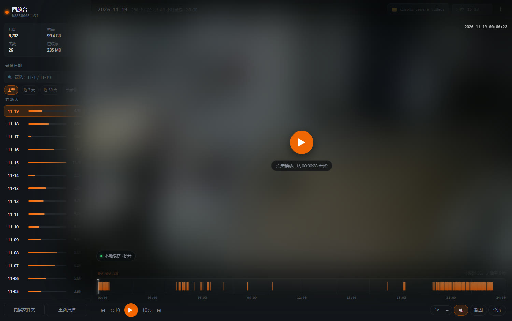
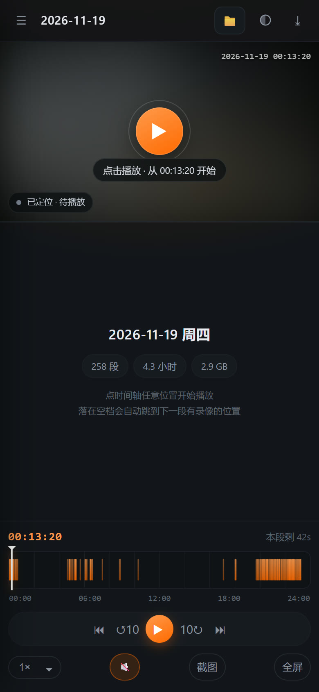

# 米家碎片录像回放台：把一分钟一个的 mp4 整成一条时间轴

米家摄像头的本地录像导出之后是一堆碎片：按小时分目录，每分钟一个 mp4。想查某天下午发生了什么，只能对着文件名一个个点开。本文介绍 [Xiaomi Camera Viewer](https://github.com/szjmhxd/xiaomi-camera-viewer) 怎么解决这个问题，以及为什么最终给出 Docker、飞牛 fnOS 应用、Windows exe 三种部署形态。

## 碎片文件缺的是「时间」概念

单个 mp4 文件没有错，错的是它们组织的方式。回放的需求是「几点几分发生了什么」，文件系统给的是「一堆文件名」：

| 回放需求 | 碎片文件现状 |
| --- | --- |
| 拖动到 14:32 直接看 | 文件名里带时间戳，但要人肉换算 |
| 连续看半小时 | 30 个文件挨个点开、关闭 |
| 知道哪段时间没录 | 不存在这个信息，翻目录靠运气 |
| 手机上翻 | 文件管理器逐个预览 |

样本库是一块 26 天、106 GB、8702 个片段的导出目录。按每分钟一个文件算，任何人肉翻找的方案都会在第一周放弃。

## 做法：服务端建索引，前端只要一条时间轴

工具本体是一个零依赖的 Python 单文件服务（`server.py`），加一套静态前端。核心流程四步：

1. **扫描归档**。文件名里有 unix 时间戳，解析后按天和摄像头归档，写进缓存目录的索引。网络盘上扫描慢，放后台线程，页面轮询进度。
2. **时间轴**。把当天的片段区间合并成可播区间，空档不生成播放点——无录像的时间点在时间轴上不可点击，直接拦截，不起播。
3. **播放**。跨片段自动连播，5 档倍速。浏览器解不了的格式（这批录像是 HEVC + G.711 a-law）由服务端转成 H.264 + AAC，转码结果落缓存，第二次播放直接 Range 读取、精确拖动。
4. **导出**。在时间轴上圈一个区间，服务端用 ffmpeg 拼成单个文件下载。

两个设计取舍值得单独说：

- **缓存放本地，不放录像目录**。录像通常在 NAS 或写满的存储卡上，又慢又没空间。缓存默认写用户本地目录，带容量上限，LRU 淘汰。
- **扫描结束不自动播放**。只显示封面和索引，点下才起播——翻日期的时候后台不该偷偷开始转码。

## 三种部署形态

| 形态 | 产物 | 适用 |
| --- | --- | --- |
| Docker | `ghcr.io/szjmhxd/xiaomi-camera-viewer` | NAS / 服务器，amd64 + arm64 |
| 飞牛 fnOS | `.fpk` 应用包 | 飞牛应用中心安装，桌面出图标 |
| Windows | 单文件 `.exe` | 免装 Python，双击运行 |

三种形态跑的是同一个服务。Docker 镜像自带 ffmpeg；exe 把 `ffmpeg.exe` 放同目录即可。

飞牛版走 fnOS 官方的「授权目录」机制：在应用设置里勾选录像文件夹，容器以只读方式挂成 `/nas`。录像文件保持原地不动，不复制、不搬移。挂载路径由平台下发的应用变量写进 compose 的 `.env` 做变量替换，compose 文件本身不被任何脚本改写。

## 安全

服务默认无鉴权，局域网内任何设备打开地址都能看这些录像。启动时会打印可访问地址和提醒；只在本机使用时加 `--host 127.0.0.1`，或用防火墙限制端口。

## 结论

碎片录像的问题不是画质，是缺少时间维度的组织。把「解析文件名 → 建时间轴 → 按需转码」放进一个小服务，8702 个文件就回到一条可以拖动的时间线上。源码、镜像和三种安装包在 [GitHub Release](https://github.com/szjmhxd/xiaomi-camera-viewer/releases/latest)，自托管即可，录像不出家门。
